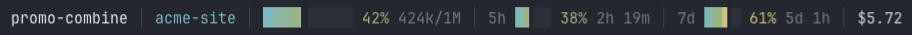
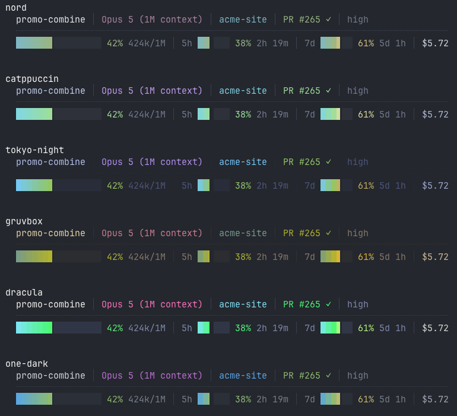

# Configuration

Every key is optional and the file itself is optional. See the
[README](README.md) to install, and [CONTRIBUTING.md](CONTRIBUTING.md) to change
the program.

Optional. Put a `~/.claude/statusline.json` in place and it is picked up on the
next render. Every key is optional, and anything invalid is ignored rather than
fatal, so a stray comma costs you a setting and not the whole bar.

```json
{
  "theme": "nord",
  "line1": ["session", "model", "location", "pr", "modes"],
  "line2": ["context", "limits", "cost"],
  "bar_width": 16,
  "limit_bar_width": 6,
  "session_name_width": 24,
  "gap": "rule",
  "gap_char": "┈",
  "gap_scale": 1.0,
  "bottom_spacing": 1
}
```

Those are the defaults, so an empty `{}` behaves the same as no file.

**`preset`** is a shortcut for a set of them. `compact` puts everything on one
row, which is worth having if four lines above your prompt is more than you
want:

```json
{ "preset": "compact" }
```



It sets `line1` to session, location, context, limits and cost, empties `line2`,
narrows the meters, and removes the gap and the bottom spacing. Model is dropped
rather than shortened, since it is identical in every session and so the least
informative thing competing for the room.

A preset is only a starting point. Anything you set explicitly still wins, so
`{"preset": "compact", "bar_width": 16}` gives you the one-row layout with the
wider meter.

`--init` writes the full default config with each key commented, which is easier
than copying it from here:

```sh
statusline --init            # refuses to overwrite an existing config
statusline --init --force    # overwrite it anyway
```

**Segments** are named, and the arrays control both what appears and in what
order. Drop one by leaving it out, move it to the other row, or reorder freely.

| | |
|---|---|
| `session` | herdr workspace label, else Claude Code's session name |
| `model` | model display name |
| `location` | directory, worktree, git branch |
| `pr` | open PR (or GitLab MR) number and review state |
| `modes` | reasoning effort, and `fast` when fast mode is on |
| `context` | context meter, percentage, token counts |
| `limits` | 5h and 7d rate limits together |
| `limit_5h`, `limit_7d` | either one on its own |
| `cost` | session cost |
| `lines` | lines added and removed this session, as `+156 -23`. Not shown by default |

**Themes**: `nord`, `catppuccin`, `tokyo-night`, `gruvbox`, `dracula`,
`one-dark`. List them with `--themes`.



**Individual colours** override whichever theme is active. Accepts `"#88C0D0"`,
`"#8cd"` or `[136, 192, 208]`.

```json
{ "theme": "gruvbox", "colors": { "brightest": "#ff00ff", "dim": [70, 70, 80] } }
```

| slot | used for |
|---|---|
| `separator` | the `│` dividers and the rule between rows |
| `dim` | unfilled meter track, PR draft |
| `muted` | token counts, countdowns, effort |
| `bright` | session cost |
| `brightest` | session name |
| `accent_a` | worktree marker |
| `accent_b` | directory, and the low end of the meter gradient |
| `accent_c` | git branch |
| `model` | model name |
| `good`, `warn`, `bad` | PR states, lines added and removed, and the upper gradient stops |
| `notice` | fast mode |

The meter gradient is derived from `accent_b`, `good`, `warn` and `bad`, so
changing those changes the meters too.

**`truecolor`** forces 24-bit on or off. Omit it to detect from `COLORTERM`.

**`responsive`** is on by default. When a row would be wider than the terminal,
segments are shed one at a time until it fits, in `drop_order`:

```json
{ "responsive": true, "drop_order": ["lines", "cost", "modes", "model", "pr", "limits", "session"] }
```

Lines changed goes first, then cost because it is glanceable elsewhere, then
the model because it is identical in every session. Anything not listed is never
shed, which is why `context` and `location` survive to the end. Set
`"responsive": false` to keep every segment and accept the wrapping.

Width comes from `$COLUMNS`, which Claude Code sets before running the command.
Claude Code captures stdout rather than attaching it to a terminal, so nothing
inside the program can measure the width itself. Needs Claude Code v2.1.153 or
later; without it, nothing is shed.

Try a theme before committing to it. Sample data, so it looks the same for
everyone:

```sh
statusline --preview              all six, stacked
statusline --preview gruvbox      just that one
statusline --preview --compact    the one-row layout
```

Rebuild after editing the Rust source, then re-run the installer to copy the
new binary into place:

```sh
cd rust && cargo build --release && cd ..
./install.sh rust
```

The binary does not rebuild itself, and `~/.claude/bin/statusline` is a copy
rather than a link, so an edit does nothing until you do both. Config changes
need neither, since the file is read at each render.
