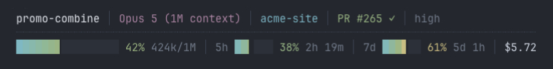
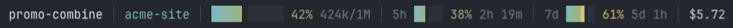

# Micro Claude Statusline

A tiny status line for [Claude Code](https://code.claude.com/docs/en/statusline).



Row one shows identity: session, model, directory, branch, open PR with review state, and effort.
Row two shows usage: context window, your 5h and 7d rate limits with reset countdowns, and session cost.

A segment with no data does not show. On a narrow terminal, rows drop segments instead of wrapping. Meters are accurate to one eighth of a column.

**One 393 KB binary. No Node, no npm, no toolchain. Zero dependencies, no network calls, no credentials. It reads stdin and prints a line.**

<details>
<summary>The same bar as text</summary>

```
promo-combine │ Opus 5 (1M context) │ acme-site │ PR #265 ✓ │ high
┈┈┈┈┈┈┈┈┈┈┈┈┈┈┈┈┈┈┈┈┈┈┈┈┈┈┈┈┈┈┈┈┈┈┈┈┈┈┈┈┈┈┈┈┈┈┈┈┈┈┈┈┈┈┈┈┈┈┈┈┈┈┈┈┈┈┈┈┈┈┈┈┈┈┈┈┈┈┈┈┈
██████▊░░░░░░░░░ 42% 424k/1M │ 5h ██▎░░░ 38% 2h 19m │ 7d ███▋░░ 61% 5d 1h │ $5.72
```

</details>

## Install

```sh
gh repo clone JordPlamondon/micro-claude-statusline
cd micro-claude-statusline
./install.sh
```

That is the full install. The installer downloads the prebuilt binary for your architecture and verifies its SHA-256. No toolchain is needed. The bar appears on your next interaction, without a restart.

The installer copies the binary to `~/.claude/bin/statusline` and merges the `statusLine` block into `~/.claude/settings.json`. Your hooks, model, and permissions do not change. You can delete this checkout after the install.

- To update: clone again and run `./install.sh` again.
- To uninstall: run `./install.sh --uninstall`. It removes the binary, the symlink, and the settings block. It keeps your `statusline.json`.
- `statusline --version` shows which build you have. Include it when you report a problem.

Prebuilt binaries are macOS only. On other systems the installer stops with a message. To compile from source instead, run `./install.sh rust`. This needs cargo.

## Check the binary against the source

The build is reproducible. Build the source and compare hashes:

```sh
./install.sh rust
shasum -a 256 ~/.claude/bin/statusline
gh release download --repo JordPlamondon/micro-claude-statusline --pattern statusline.sha256 -O - | grep arm64
```

Equal hashes show the released binary came from this source. A checksum alone shows only that your download is not corrupted, because it ships in the same release as the binary.

## Speed

CPU for one render, against the eleven-line bash example in the Claude Code docs, extended with a token count so both show the same information:

| | CPU per render |
|---|---|
| docs example (bash + 4 jq) | ~100 ms |
| this | **~2.2 ms** |

Run `python3 scripts/bench.py` to reproduce these numbers. It needs `jq` and takes about half a minute.

One session does not feel the difference. Many concurrent sessions do, because the status line runs on every event in every session.

## What it reads

- stdin: the payload from Claude Code
- `~/.claude/statusline.json`, if you create one
- `<repo>/.git/HEAD` for the branch, without running `git`
- `~/.config/herdr/session.json`, only when `$HERDR_WORKSPACE_ID` is set

It writes to stdout and nothing else. Each claim, and how to check it:

| | | how to check |
|---|---|---|
| Third-party crates | 0 | `grep -c '^name = ' rust/Cargo.lock` is 1; the test suite fails if it is not |
| Network calls | 0 | runs under `sandbox-exec` with `(deny network*)` |
| Subprocesses | 0 | no `Command` in `rust/src` |
| Credentials read | 0 | the rate limits arrive in the payload |
| `unsafe` blocks | 0 | `#![forbid(unsafe_code)]` |
| Files opened | 4 | listed above, each with a size cap |
| Lines of Rust | ~1,900 | small enough to read in full |
| Binary | 393 KB | reproducible, see above |

Some status line tools read your OAuth token from the keychain and call the usage API. This one does not need a token or a network: the rate limits arrive in the payload Claude Code already provides.

All input is treated as hostile. Control characters are stripped from rendered text. Every read has a size cap. The parser is tested against 1,500 malformed payloads on every test run.

## herdr is optional

If you use [herdr](https://herdr.dev), its workspace label leads the row. If not, that slot shows the Claude Code session name, set with `--name` or `/rename`. With neither, the segment does not show. No configuration is needed.

## Terminal support

24-bit colour when `COLORTERM` is `truecolor` or `24bit`, and a 256-colour approximation otherwise. The glyphs are standard Unicode, not Nerd Font. No patched font is needed.

## Config

Optional. Create `~/.claude/statusline.json`. It applies on the next render. Invalid input costs one setting, not the whole bar.

```sh
statusline --init       # writes the defaults, with a comment for every key
```

The three most common changes:

```jsonc
{ "theme": "gruvbox" }        // six themes, --themes lists them
{ "preset": "compact" }       // everything on one row
{ "line2": ["context"] }      // drop the rate limits and cost
```



[CONFIG.md](CONFIG.md) documents every segment, colour slot, and override. To change the program itself, see [CONTRIBUTING.md](CONTRIBUTING.md).

## Notes

- `refreshInterval` in `settings.json` applies to every session. 60 matches the finest thing displayed.
- A custom status line hides two footer hints: `? for shortcuts` and `hold space to speak`. Claude Code's own PR badge shows the same PR as the `pr` segment. Drop `pr` from `line1` to see it once.
- Keep `padding` at 0. Negative values clip the leftmost character.

## License

MIT. See [LICENSE](LICENSE).
