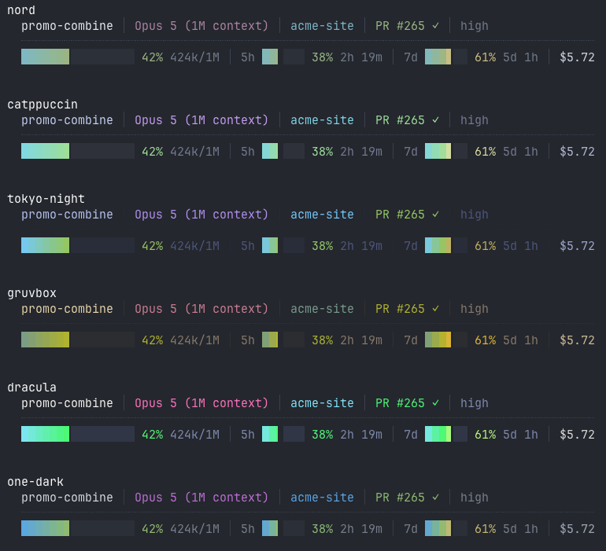

# claude-statusline

A status line for [Claude Code](https://code.claude.com/docs/en/statusline). Six
themes, configurable segments, Nord by default.


As text, for anyone reading this in a terminal:

```
promo-combine │ Opus 5 (1M context) │ acme-site │ PR #265 ✓ │ high
┈┈┈┈┈┈┈┈┈┈┈┈┈┈┈┈┈┈┈┈┈┈┈┈┈┈┈┈┈┈┈┈┈┈┈┈┈┈┈┈┈┈┈┈┈┈┈┈┈┈┈┈┈┈┈┈┈┈┈┈┈┈┈┈┈┈┈┈┈┈┈┈┈┈┈┈┈┈┈┈┈
██████▊░░░░░░░░░ 42% 424k/1M │ 5h ██▎░░░ 38% 2h 19m │ 7d ███▋░░ 61% 5d 1h │ $5.72
```

Row one is identity: session name, model, directory, git branch, open PR with
review state, reasoning effort. Row two is usage: how full the context window
is, your 5-hour and 7-day rate limits with countdowns to reset, and session cost.

Meters use a positional gradient and eighth-width block characters, so the fill
is accurate to an eighth of a column rather than rounding to whole cells.

Every segment disappears when its data is absent, so early in a session you get
just the model and directory rather than a row of zeroes. On a narrow terminal
it sheds lower-priority segments rather than letting the row wrap.

**Zero dependencies, no network calls, no credentials. It reads stdin and prints
a line.**

## Install

```sh
gh repo clone JordPlamondon/claude-statusline
cd claude-statusline
./install.sh
```

**That is the whole install. No toolchain, nothing to compile.** It downloads a
prebuilt binary, which is 809 KB and the only thing left on your machine
afterwards.

It applies on your next interaction. No restart.

The installer merges into `~/.claude/settings.json`, so your hooks, model and
permissions are left alone. The binary is copied to `~/.claude/bin/statusline`,
so **you can delete this checkout straight after**. It is also symlinked into
`~/.local/bin` when that is on your PATH, which is what makes the `statusline`
command work.

To update later, clone again and re-run `./install.sh`.

There is a binary per architecture and the installer picks the right one. macOS
only.

Deliberately not a universal binary: on Apple Silicon, exec-ing a fat binary
that contains an x86_64 slice costs about 20 ms every time, roughly ten times
this program's entire runtime. Measured here as 2.4 ms for a thin arm64 binary,
2.4 ms for a fat one containing only arm64, and 22.1 ms once the Intel slice is
added. The fat header is free; the Intel slice is not.

### Building it yourself instead

Optional, and only worth it if you would rather compile the source than trust a
binary someone else built, or you are on Linux.

```sh
./install.sh rust
```

That needs `cargo`, which means a Rust toolchain at roughly 1.5 GB. Everyone
else should ignore this and use the command above.

The installer verifies a SHA-256 before making the binary executable, and
refuses to continue if the checksum is missing or does not match. Worth being
clear about what that covers: the checksum ships in the same release as the
binary, so it protects against a corrupted or truncated download, not against a
compromised release or GitHub account. The real assurance is that the source is
here to read and `./install.sh rust` reproduces the binary locally.

## Speed

Measured on an M-series Mac against the eleven-line bash example from the Claude
Code docs, extended with a token count so both show comparable information.
CPU time per render, median of repeated runs:

| | CPU per render |
|---|---|
| docs example (bash + 4 jq) | ~110 ms |
| this | **~2.5 ms** |

About **40x cheaper**. The reason is process count: each `jq` in a shell status
line is another process, so cost grows as you add fields. This parses the
payload once, so it does not.

None of that is perceptible at one session. The status line re-runs on every
event, debounced at 300 ms, so it only compounds when several Claude Code
sessions are working at once. Taking that ceiling as the worst case, and
counting a whole CPU core as 100%:

| sessions working at once | docs example | this |
|---|---|---|
| 1 | 43% of a core | 1% |
| 5 | 215% | 5% |
| 10 | 430% | 10% |

If you only want a status line and do not care about this, the docs example is
eleven lines of bash and will serve you fine.

## What it reads

- stdin, the JSON payload Claude Code provides
- `~/.claude/statusline.json`, your config, if you make one
- `<repo>/.git/HEAD`, to show the branch without forking `git`
- `~/.config/herdr/session.json`, only if `$HERDR_WORKSPACE_ID` is set

It writes to stdout and nothing else. No network, no subprocesses, no
credentials, no `unsafe`, and no third-party crates: `Cargo.lock` contains only
this package. Around 1,400 lines, so reading it before you run it is realistic.

Worth stating because some status lines fetch quota from an API and therefore
need a token in your keychain. This one does not: the 5h and 7d rate limits
arrive in the stdin payload already, so there is nothing to authenticate and
nothing to leak.

Input is treated as untrusted. JSON nesting is capped at 64 levels so a
pathological payload cannot overflow the stack, and every config dimension is
clamped, so a mistyped `bar_width` cannot make the renderer allocate without
limit. Malformed input of any kind prints nothing rather than failing loudly.

## herdr is optional

If you use [herdr](https://herdr.dev), the workspace label from its tab bar
leads the row, which is what tells panes apart when several are open on the same
project. If you do not, that slot falls back to Claude Code's own session name,
set with `--name` or `/rename`. If neither exists the segment is omitted.

Nothing to configure either way.

## Terminal support

24-bit colour when `COLORTERM` is `truecolor` or `24bit`, and a 256-colour
approximation otherwise. The glyphs (`⎇ ⑂ ┈ ░ ▏▎▍▌▋▊▉█`) are standard Unicode,
not Nerd Font, so no patched font is needed.

## Config

Optional. Put a `~/.claude/statusline.json` in place and it is picked up on the
next render. Every key is optional, and anything invalid is ignored rather than
fatal, so a stray comma costs you a setting and not the whole bar.

```json
{
  "theme": "nord",
  "line1": ["session", "model", "location", "pr", "modes"],
  "line2": ["context", "limits", "cost"],
  "bar_width": 16,
  "limit_bar_width": 6,
  "session_name_width": 24,
  "gap": "rule",
  "gap_char": "┈",
  "gap_scale": 1.0,
  "bottom_spacing": 1
}
```

Those are the defaults, so an empty `{}` behaves the same as no file. `--init`
writes exactly this, with each key commented, which is easier than copying it
from here:

```sh
statusline --init            # refuses to overwrite an existing config
statusline --init --force    # overwrite it anyway
```

**Segments** are named, and the arrays control both what appears and in what
order. Drop one by leaving it out, move it to the other row, or reorder freely.

| | |
|---|---|
| `session` | herdr workspace label, else Claude Code's session name |
| `model` | model display name |
| `location` | directory, worktree, git branch |
| `pr` | open PR number and review state |
| `modes` | reasoning effort, and `fast` when fast mode is on |
| `context` | context meter, percentage, token counts |
| `limits` | 5h and 7d rate limits together |
| `limit_5h`, `limit_7d` | either one on its own |
| `cost` | session cost |

**Themes**: `nord`, `catppuccin`, `tokyo-night`, `gruvbox`, `dracula`,
`one-dark`. List them with `--themes`.



**Individual colours** override whichever theme is active. Accepts `"#88C0D0"`,
`"#8cd"` or `[136, 192, 208]`.

```json
{ "theme": "gruvbox", "colors": { "brightest": "#ff00ff", "dim": [70, 70, 80] } }
```

| slot | used for |
|---|---|
| `separator` | the `│` dividers and the rule between rows |
| `dim` | unfilled meter track, PR draft |
| `muted` | token counts, countdowns, effort |
| `bright` | session cost |
| `brightest` | session name |
| `accent_a` | worktree marker |
| `accent_b` | directory, and the low end of the meter gradient |
| `accent_c` | git branch |
| `model` | model name |
| `good`, `warn`, `bad` | PR states, and the upper gradient stops |
| `notice` | fast mode |

The meter gradient is derived from `accent_b`, `good`, `warn` and `bad`, so
changing those changes the meters too.

**`truecolor`** forces 24-bit on or off. Omit it to detect from `COLORTERM`.

**`responsive`** is on by default. When a row would be wider than the terminal,
segments are shed one at a time until it fits, in `drop_order`:

```json
{ "responsive": true, "drop_order": ["cost", "modes", "model", "pr", "limits", "session"] }
```

Cost goes first because it is glanceable elsewhere, then the model because it is
identical in every session. Anything not listed is never shed, which is why
`context` and `location` survive to the end. Set `"responsive": false` to keep
every segment and accept the wrapping.

Width comes from `$COLUMNS`, which Claude Code sets before running the command.
Claude Code captures stdout rather than attaching it to a terminal, so nothing
inside the program can measure the width itself. Needs Claude Code v2.1.153 or
later; without it, nothing is shed.

Try a theme before committing to it. Sample data, so it looks the same for
everyone:

```sh
statusline --preview            all six, stacked
statusline --preview gruvbox    just that one
```

Rebuild after editing the Rust source, then re-run the installer to copy the
new binary into place:

```sh
cd rust && cargo build --release && cd ..
./install.sh rust
```

The binary does not rebuild itself, and `~/.claude/bin/statusline` is a copy
rather than a link, so an edit does nothing until you do both. Config changes
need neither, since the file is read at each render.

## Cutting a release

```sh
./scripts/build-release.sh v1.0.1
```

Builds both Apple targets, merges them with `lipo`, writes a checksum, smoke
tests the result and uploads it. Needs `rustup target add x86_64-apple-darwin`
once.

## After changing output

```sh
cd rust && cargo build --release && cd ..
python3 scripts/golden.py
```

372 recorded cases in `tests/golden.txt`, compared byte for byte. Every whole
percent through the meters, token and duration boundaries, all PR states,
worktrees, every theme, config permutations, ten terminal widths, and missing
or malformed input, under both 24-bit and 256-colour.

Time is pinned with `$STATUSLINE_TEST_PINNED_CLOCK`, `$COLUMNS` is pinned, and
`$HOME` is redirected to a scratch directory, so the same input produces the
same bytes on any machine at any time of day.

If a change is intended, re-record it and read the diff before committing:

```sh
python3 scripts/golden.py --update
git diff tests/golden.txt
```

This is worth running. The case list caught a currency bug that only appeared at
`$0.005`, where scaling by 100 before rounding lands on exactly `0.5` in
floating point and loses the tie-break.

The expectations were originally recorded from a separate Python implementation
that has since been removed, so they pin reviewed behaviour rather than
whatever the current code happens to do.

## Notes

`refreshInterval` is seconds, minimum 1, and it applies to every session whether
or not anything on screen is time-based. 60 matches the finest thing displayed,
which is the rate-limit countdown in minutes. Lower values cost real CPU when
several sessions are open.

Negative `padding` in `settings.json` shifts the bar left but the renderer does
not account for it, so the leftmost character is clipped until a keystroke
forces a repaint. Leave it at 0.

A custom status line suppresses two of Claude Code's own footer hints, `? for
shortcuts` and `hold space to speak`. Contextual hints such as `esc to
interrupt` stay.

The open-PR badge in Claude Code's footer shows the same PR as the `pr` segment
here. This adds the review state icon; if you would rather not have it twice,
drop `pr` from `line1`.

`$STATUSLINE_TEST_PINNED_CLOCK` exists so the golden files can check exact
duration boundaries against a fixed instant. Setting it outside the tests
freezes the rate-limit countdowns, which is why the name is that unwieldy.
