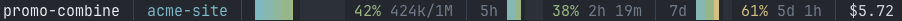

# claude-statusline

A status line for [Claude Code](https://code.claude.com/docs/en/statusline).


Row one is identity: session, model, directory, branch, open PR with review
state, effort. Row two is usage: context window, your 5h and 7d rate limits with
reset countdowns, and session cost.

Segments disappear when their data is absent, and shed rather than wrap on a
narrow terminal. Meters are accurate to an eighth of a column.

**Zero dependencies, no network calls, no credentials. It reads stdin and prints
a line.**

<details>
<summary>The same bar as text, for reading in a terminal</summary>

```
promo-combine │ Opus 5 (1M context) │ acme-site │ PR #265 ✓ │ high
┈┈┈┈┈┈┈┈┈┈┈┈┈┈┈┈┈┈┈┈┈┈┈┈┈┈┈┈┈┈┈┈┈┈┈┈┈┈┈┈┈┈┈┈┈┈┈┈┈┈┈┈┈┈┈┈┈┈┈┈┈┈┈┈┈┈┈┈┈┈┈┈┈┈┈┈┈┈┈┈┈
██████▊░░░░░░░░░ 42% 424k/1M │ 5h ██▎░░░ 38% 2h 19m │ 7d ███▋░░ 61% 5d 1h │ $5.72
```

</details>

## Install

```sh
gh repo clone JordPlamondon/claude-statusline
cd claude-statusline
./install.sh
```

**That is the whole install.** It downloads a prebuilt binary, 393 KB, and that
is the only thing left on your machine. No toolchain, nothing to compile. It
applies on your next interaction, no restart.

The installer merges into `~/.claude/settings.json`, leaving your hooks, model
and permissions alone. The binary is copied to `~/.claude/bin/statusline`, so
**you can delete this checkout straight after**, and symlinked into
`~/.local/bin` when that is on your PATH.

To update, clone again and re-run `./install.sh`.

Prebuilt binaries are macOS only. There is one per architecture, the installer
picks it, and verifies its SHA-256 before making it executable. On anything else
it stops and tells you rather than installing a binary that cannot run.

Prefer to compile it yourself? `./install.sh rust`, which needs cargo and
therefore about 1.5 GB of Rust toolchain. Everyone else should ignore that.

The source has no platform-specific code, so a Linux build should work, but
nobody has tried it. If you do, say whether it worked.

## Speed

CPU per render, measured against the eleven-line bash example in the Claude Code
docs extended with a token count, so both show comparable information:

| | CPU per render |
|---|---|
| docs example (bash + 4 jq) | ~110 ms |
| this | **~2.5 ms** |

Each `jq` in a shell status line is another process, so its cost grows as you
add fields. This parses the payload once.

Invisible at one session. It compounds when several are working at once, since
the status line re-runs on every event:

| sessions at once | docs example | this |
|---|---|---|
| 1 | 43% of a CPU core | 1% |
| 10 | 430% | 10% |

If you only want a status line and none of this matters, the docs example is
eleven lines of bash and will serve you fine.

## What it reads

- stdin, the payload Claude Code provides
- `~/.claude/statusline.json`, if you make one
- `<repo>/.git/HEAD`, for the branch, without forking `git`
- `~/.config/herdr/session.json`, only when `$HERDR_WORKSPACE_ID` is set

Writes to stdout and nothing else. No network, no subprocesses, no credentials,
no `unsafe`, and no third-party crates: `Cargo.lock` contains only this package.

Everything it did not write is treated as hostile. Control characters are
stripped from all rendered text, since a directory name containing an escape
would otherwise reach your terminal as an escape.

Some status lines fetch quota from an API and need a token in your keychain.
This one does not, because the rate limits arrive in the payload already.

## herdr is optional

If you use [herdr](https://herdr.dev), the workspace label from its tab bar
leads the row, which is what tells panes apart when several are open on the same
project. If you do not, that slot falls back to Claude Code's own session name,
set with `--name` or `/rename`. If neither exists the segment is omitted.

Nothing to configure either way.

## Terminal support

24-bit colour when `COLORTERM` is `truecolor` or `24bit`, and a 256-colour
approximation otherwise. The glyphs (`⎇ ⑂ ┈ ░ ▏▎▍▌▋▊▉█`) are standard Unicode,
not Nerd Font, so no patched font is needed.

## Config

Optional. Drop a `~/.claude/statusline.json` in place and it applies on the next
render, no restart. Anything invalid is ignored rather than fatal, so a stray
comma costs you a setting and not the whole bar.

```sh
statusline --init       # writes the defaults, every key commented
```

Three things most people want:

```json
{ "theme": "gruvbox" }        // six themes, --themes lists them
{ "preset": "compact" }       // everything on one row
{ "line2": ["context"] }      // drop the rate limits and cost
```



Full reference in [CONFIG.md](CONFIG.md): every segment, every colour slot,
responsive behaviour, and per-slot overrides.

## Changing it

See [CONTRIBUTING.md](CONTRIBUTING.md) for the test suite and how releases are
cut. Config changes need none of that: the file is read fresh on every render.

## Notes

`refreshInterval` in `settings.json` applies to every session whether or not
anything on screen is time-based. 60 matches the finest thing displayed.

A custom status line suppresses two of Claude Code's own footer hints, `? for
shortcuts` and `hold space to speak`. Contextual ones like `esc to interrupt`
stay. Its open-PR badge shows the same PR as the `pr` segment here, so drop
`pr` from `line1` if you would rather not see it twice.

Negative `padding` in `settings.json` clips the leftmost character until a
keystroke forces a repaint. Leave it at 0.

## License

MIT. See [LICENSE](LICENSE).
